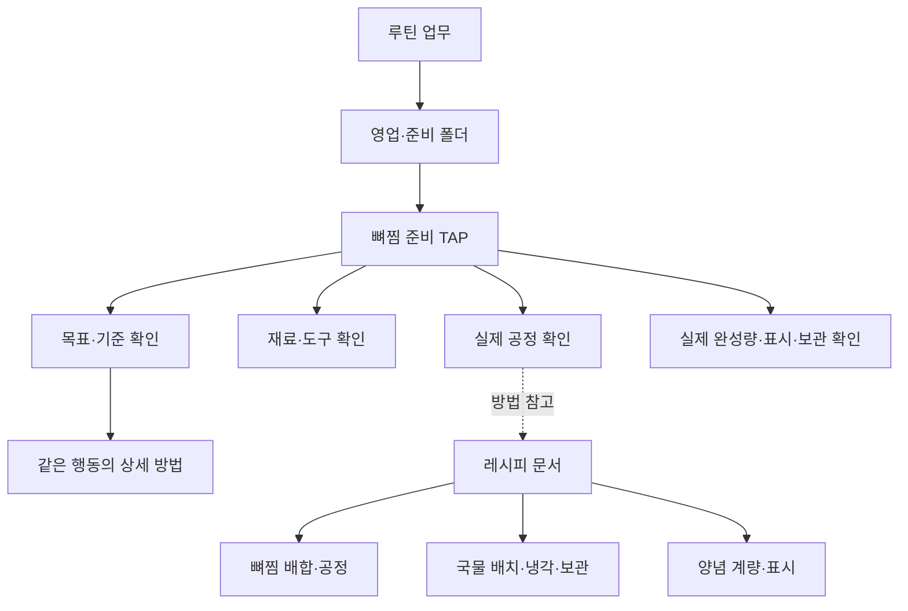

# 솔담 뼈찜 · 가상 매장 매뉴얼 본보기

실제 매장·직원·영업·수행 기록이 아닌 **가상의 운영 구성**이다. 사용자는 구조와 정리 깊이를 살펴보고 필요한 TAP만 선택해 가져온다. 실제 제품·장비·파트·시간·장소·기준은 매장에서 확인하며 가져오기가 업무 활성화나 현장 검수 완료를 뜻하지 않는다.

## 본보기 규모

20석, 조리·준비/설거지·홀/포장·관리4파트, 5시간대, 15장소(테이블5개×설정4석 포함), 메뉴3개를 가정했다. 테이블 좌석은 설정 용량이며 손님 수가 아니다. 운영 설정 예시는 별도 blueprint이고 공용 콘텐츠의 본문에 실제 담당자·매장 ID를 넣지 않는다.

- 처음 설정4TAP: 운영 기준, 장소·도구, 보관·표시, 첫 근무·버디.
- 정기 관리4TAP: 주간 장비, 주간 재고, 월간 동선, 월간 문서.
- 루틴12TAP: 근무 시작, 주방/홀 오픈, 실제 입고, 준비 배치, 식기 회전, 서비스, 포장, 브레이크/교대, 영업 중 정리, 주방/홀 마감.
- 레시피4TAP: 뼈찜, 국물, 양념, 품질·문제 대응.
- 교육·참고2TAP: 처음 쓰는 장비, 이상 발견과 재확인.

총26TAP·108행동/내용 단락·15본보기 폴더다. 각 단락은 **장소·준비물 / 방법 / 확인 기준 / 문제 발생 시 조치**를 적었다. 레시피 단락은 읽는 내용이며 일일 체크 항목이 아니다. 발주·입고·실측·완성량, 본인 연습·버디 확인, 발견·조치·재확인을 구별한다.

## 구성 예

## 실행 정책 본보기

루틴은 실제 파트·시간대마다 공동으로 확인한다. 입고는 실제 물품을 받을 때, 준비 배치는 실제 작업을 시작할 때의 별도 사례다. 물품을 받지 않은 날 새 일일 입고 체크를 만들지 않는다. 주간 관리는 선택한 요일, 월간 관리는 선택한 날짜와 휴무일 정책으로 한정한다. 처음 설정·레시피·교육은 읽는 자료가 기본이다.

가상 월요일은 오픈·영업·브레이크·저녁·마감과 준비 배치1회를 보여준다. 실제 입고가 없으면 입고 작업이 없다. 예시 시간과 인원을 실제 근무표·급여·고객 주문으로 처리하지 않는다. 레시피와 관련 루틴은 stable source ID로 연결하며 일부만 가져온 경우 빠진 관련 문서도 찾을 수 있게 한다.

## 수치·사진·검증 범위

2인 배합, 5L배치, 10인분 목표 등은 **정리 방식의 가상 수치**이다. 맛·수율·보관기한·공정 안전성을 검증한 배합이 아니다. 제품 표시·검토된 매장 기준과 실제 측정을 사용하고 미확인 값을 예시로 채우지 않는다. 실제 현장 사진은 제공하지 않으며 사진이 있는 것처럼 표시하지 않는다. 매장에서 확인한 장소·장비 사진을 연결하는 깊이를 설명한다.

[식약처 대량조리음식 식중독 주의요령](https://www.mfds.go.kr/brd/m_827/view.do?seq=3607)을 국물의 방치·냉각·보관 원칙에 참고했다. 특정 메뉴의 보관기한이나 장비 공정을 새로 인증한 것은 아니다. 세척 제품의 농도·시간은 제조사 표시와 검토한 기준을 따르며 임의 배합을 제공하지 않는다.

## 원본

`developer/fictional_store_examples.json`: 가상 매장 프로필·운영 blueprint·26TAP 상세 원본. `scripts/build-manual-market.mjs`가 공용 발행본을 만들며 `.local/`이나 실제 운영 데이터를 사용하지 않는다. 분류·본문·운영 예시는 각각 보존되고 실제 가져오기·등록·활성화는 기존 권한과 revision 검사를 따른다.
